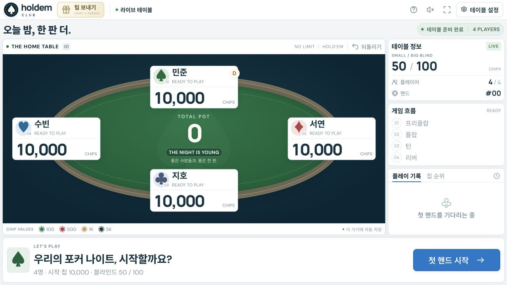
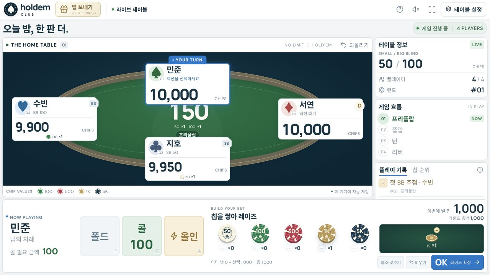
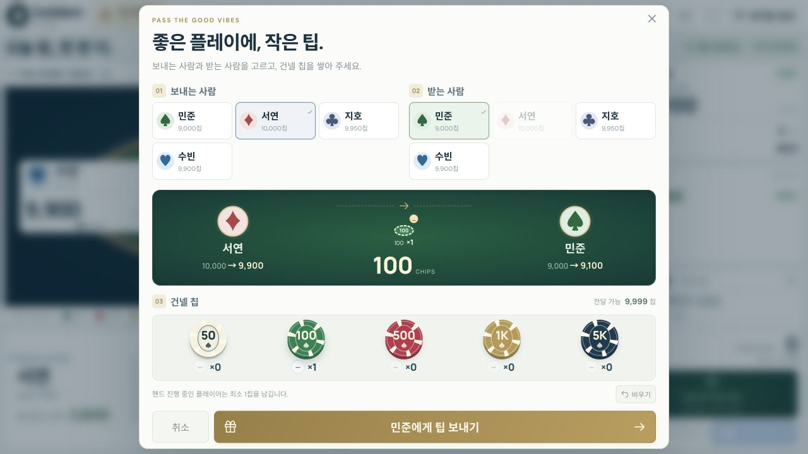
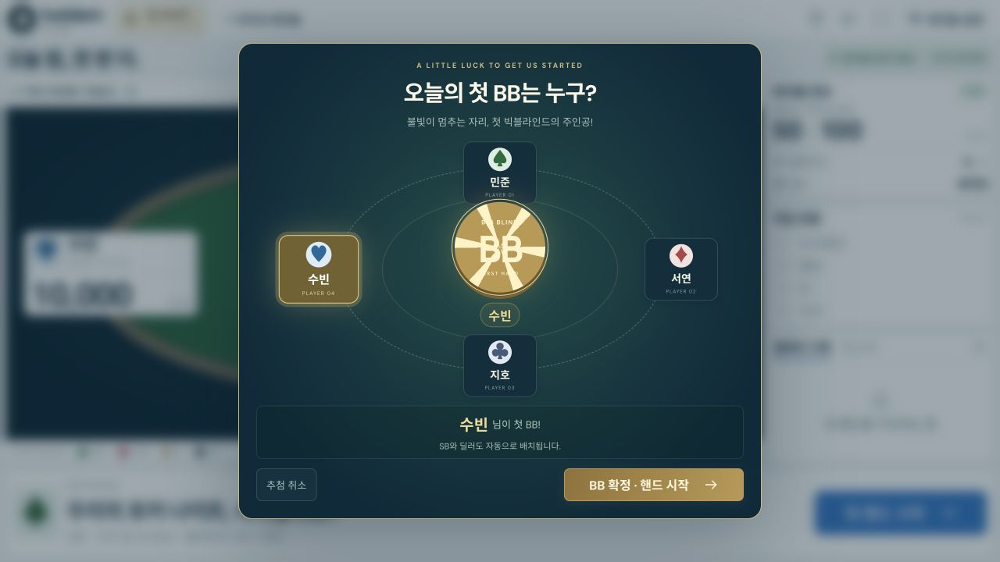
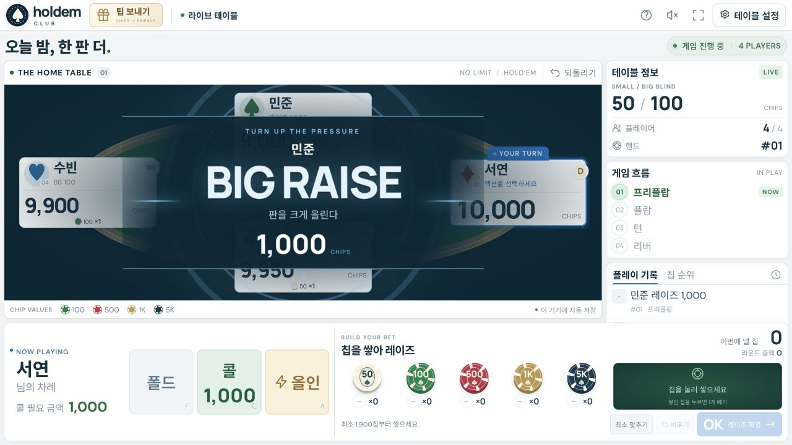
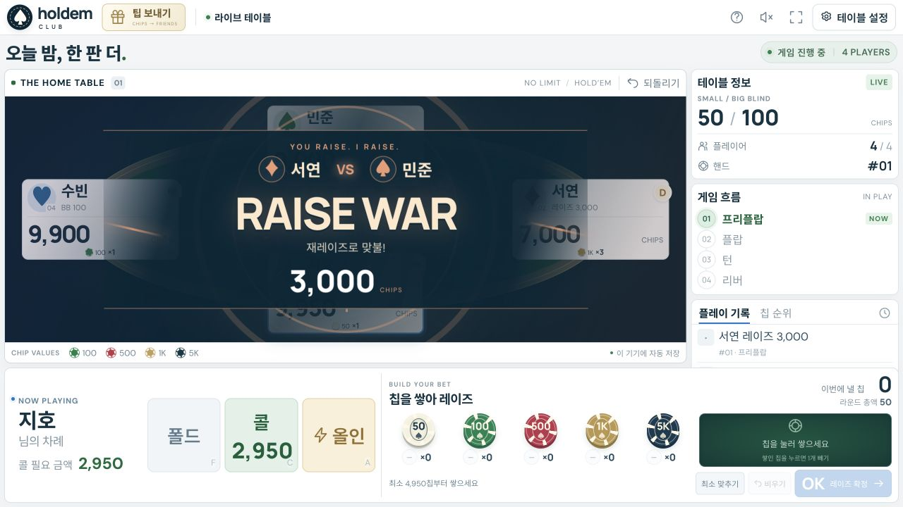
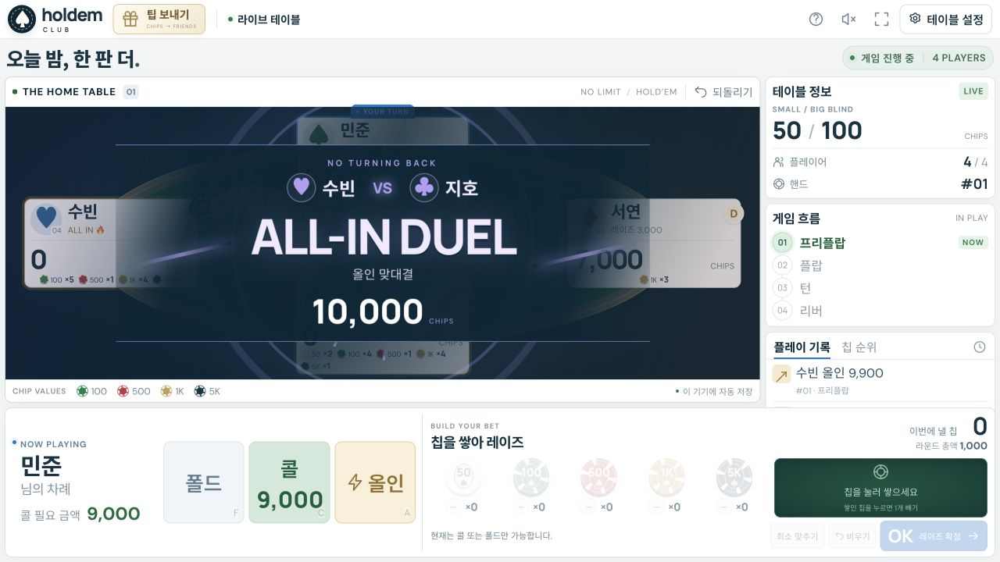
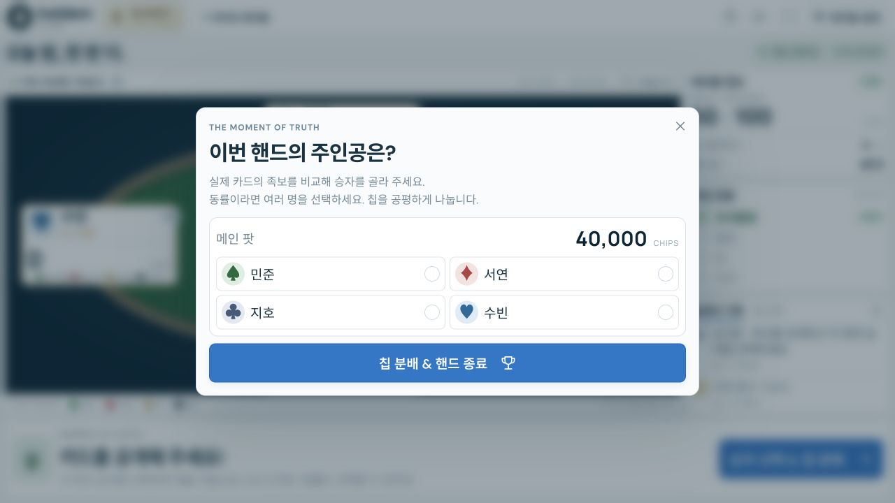

# Holdem Club ♠

10월 31일, 횡성의 한 휴양림 매점에서 플라스틱 카드 하나를 샀습니다.
텍사스 홀덤을 하게 되었고, 다들 칩이 없어서 베팅하는 맛이 없음에 아쉬워하고 있었죠.
그곳에서 10분만에 이 앱이 탄생했습니다.

3~6명이 실제 카드로 텍사스 홀덤을 즐길 때, 한 화면에서 가상 칩과 베팅을 관리하는 로컬 웹앱입니다. 밝은 패널에 네이비 테이블 배경, 포커 그린 펠트, 골드 테두리와 블루 버튼을 조합했습니다. 칩 이동 애니메이션, 올인 화면 효과, 승리 컨페티와 선택형 효과음을 제공합니다. 색상은 `palette.css`, 배치와 큰 글씨는 `compact.css`, 칩 선택과 스택 표현은 `chip-betting.css`에서 관리합니다.

## 실행

macOS에서는 **`시작하기.command`를 더블 클릭**하면 브라우저까지 자동으로 열립니다. 설치된 nvm이 있다면 사용 가능한 기본 Node를 자동으로 불러옵니다. Node.js 20 이상이 필요하며, 별도 패키지 설치는 없습니다.

```sh
git clone https://github.com/Uniaut/holdem-club.git
cd holdem-club
npm start
```

브라우저에서 http://localhost:5173 을 엽니다. 터미널의 Node가 올바르게 선택되지 않았다면 `nvm use default` 후 실행하거나 위의 더블 클릭 실행 파일을 이용하세요. 서버 종료는 실행 중인 터미널에서 Ctrl+C를 누르세요. 다른 포트는 `PORT=5174 npm start`로 지정할 수 있습니다.

## 플레이

1. **테이블 설정**에서 인원(3~6명), 이름, 시작 칩, 스몰/빅 블라인드를 정합니다.
2. **첫 핸드 시작**을 누르면 플레이어 사이를 불빛이 돌며 **첫 BB를 랜덤 추첨**합니다. 회전 칩과 스파크 효과로 결과를 공개하며, **바로 선정**으로 연출을 건너뛸 수 있습니다. **BB 확정 · 핸드 시작**을 누르면 선택된 BB를 기준으로 SB·딜러·첫 차례를 배치하고 블라인드를 올립니다. 카드를 실제로 나누고 플레이하세요. 추첨을 취소하면 칩이나 게임 상태는 바뀌지 않습니다. 다음 핸드부터는 버튼을 순서대로 돌립니다. 기본은 4명, 각 10,000칩, 블라인드 50/100입니다.
3. 현재 차례인 사람의 **폴드 / 체크·콜 / 레이즈 / 올인**을 선택합니다. 레이즈는 **칩을 클릭해 쌓은 뒤 OK로 확정**합니다. 기본 권종은 50·100·500·1,000·5,000이며, 블라인드와 보유 칩에 따라 잔돈 칩과 큰 칩이 추가됩니다. `×개수`, **이번에 낼 칩**, **라운드 총액**을 확인하세요. 예를 들어 이미 SB 50을 냈다면 칩 150을 새로 쌓아 총 200으로 레이즈합니다. 칩을 고르는 동안 보유 칩과 차례는 바뀌지 않습니다. `−` 버튼이나 쌓인 칩을 누르면 1개를 빼고, **비우기**로 초기화하거나 **최소 맞추기**로 최소 금액을 채울 수 있습니다. 확정한 칩의 권종과 개수는 테이블과 팟에도 그대로 표시됩니다.
4. 라운드가 끝나면 커뮤니티 카드를 실제로 펼치고 다음 라운드를 진행합니다.
5. 쇼다운에서는 실제 족보를 확인하고 팟마다 승자를 선택합니다. 동률인 사람은 함께 선택하세요. 사이드 팟, 미콜 금액 반환, 동률 분배와 딜러 왼쪽부터의 나머지 칩 배분을 계산합니다.
6. 다음 핸드부터 딜러 버튼이 이동하고 칩을 소진한 자리는 건너뜁니다. 2명만 남으면 헤즈업 순서를 적용합니다.

단축키: **F** 폴드, **C** 체크/콜, **A** 올인 확인 창, **⌘/Ctrl+Z** 실행 취소. 입력창과 팝업 안에서는 액션 단축키가 작동하지 않습니다.

## 팁 보내기

왼쪽 상단의 **선물 아이콘 / 팁 보내기** 버튼을 누릅니다. 보내는 사람과 받는 사람을 고르고, 권종별 칩을 쌓으면 양쪽 잔액의 변화를 미리 보여줍니다. **팁 보내기**로 확정하면 실제로 보유 칩이 이동하고, 칩이 상대 플레이어에게 날아가는 효과와 기록을 남깁니다. 취소하면 변화가 없고, 확정 후에는 **되돌리기**로 복구할 수 있습니다.

팁은 플레이어의 보유 칩끼리 이동하므로 테이블의 총 칩, 팟, 베팅액, 현재 차례는 유지됩니다. 모달을 열기 전에 고른 레이즈 칩도 유지됩니다. 팁을 보내 잔액보다 선택한 베팅 칩이 많아졌다면 OK가 비활성화되며 칩을 빼서 조정할 수 있습니다. 핸드에 참여 중인 플레이어는 팁 때문에 차례가 달라지지 않도록 최소 1칩을 남깁니다. 이미 올인한 플레이어가 받은 팁은 현재 핸드의 올인 상태를 바꾸지 않습니다.

## 베팅 이펙트

큰 레이즈에는 **BIG RAISE** 충격파, 강한 재레이즈에는 **RAISE WAR** 맞불, 큰 콜에는 **BIG CALL**, 두 명 이상 올인에는 **ALL-IN DUEL / N-WAY ALL IN** 연출이 나옵니다. 실제 올인 승리 결과에 따라 **DOUBLE UP**, **TRIPLE UP**, 짧은 스택의 **COMEBACK**을 구분하고, 큰 팟 획득과 여러 승자의 팟 분배에도 별도 연출을 보여줍니다. 효과는 테이블 안에서 1.6~2초 후 사라지며 베팅 버튼 입력을 막지 않습니다. 팟의 칩도 정산 시 각 플레이어에게 이동합니다.

모든 강조 연출은 **실제로 확정된 게임 상태의 변화**로 판정합니다. 칩 고르기·빼기·비우기·설정·탭 이동에는 강조나 효과음을 붙이지 않습니다. 작은 콜, 최소 레이즈, 작은 팟 승리와 큰 미콜 금액의 반환에도 큰 연출을 띄우지 않습니다. 큰 콜·레이즈는 블라인드, 팟, 보유 칩 대비 금액으로 판단합니다. 효과음은 기존 소리 버튼이 켜졌을 때만 나옵니다. 효과 끄기와 OS 동작 줄이기를 따르며, 실행 취소 시 남아 있는 축하 연출도 지웁니다.

게임 이벤트 판정은 `bet-events.js`, 연출은 `bet-effects.js`와 `bet-effects.css`에서 관리합니다.

진행 상황과 최근 40회 실행 취소 기록은 현재 브라우저의 localStorage에 저장됩니다. 브라우저 데이터를 지우거나 시크릿 창을 닫으면 저장이 사라질 수 있습니다. 네트워크 멀티플레이, 카드 배분, 자동 족보 판정, 실제 금전 결제는 포함하지 않습니다. 효과음은 상단에서 켤 수 있고, 테이블 설정에서 화려한 이펙트를 끌 수 있습니다. OS의 동작 줄이기도 존중합니다.

## 검증

```sh
npm test
```

블라인드/턴 순서, 레이즈 최소 금액과 재오픈, 올인/사이드 팟/반환, 폴드, 동률과 홀수 칩, 헤즈업, 무작위 플레이의 칩 보존을 검증합니다. 칩 선택은 권종별 합계, 잔액 한도, 기존 블라인드 포함 계산, 짧은 올인, 사용자 지정 블라인드의 잔돈을 추가 검증합니다.

팁은 총 칩 보존, 입력·잔액 검증, 팟·차례·베팅 권리 유지, 올인 상태 유지와 취소용 스냅샷을 검증합니다. 첫 BB 추첨은 인원별 모든 BB 후보의 딜러·SB·첫 차례, 빈자리 제외, 헤즈업, 다음 핸드의 정상 회전을 검증합니다.

UI는 HTML/CSS/ES modules로 작성되었으며 런타임 의존성이 없습니다. 색상은 `palette.css`, 화면을 채우는 배치와 큰 글씨는 `compact.css`에서 관리합니다. 바깥 여백은 4~6px이며, 플레이어 이름과 칩 숫자는 테이블 너비에 맞춰 커집니다. 긴 이름과 큰 금액은 칸에 맞게 자동 축소됩니다. 작은 화면에서는 베팅 컨트롤이 테이블 바로 아래에 표시됩니다. 글꼴은 Google Fonts를 사용할 수 있을 때 불러오며, 오프라인에서는 시스템 글꼴로 동작합니다.

## 기능 소개 · 스크린샷

현재 배포 버전에서 촬영한 화면입니다. 이름과 칩은 데모 게임 데이터입니다.

### 공유 화면 테이블 · 밝은 팔레트와 큰 글씨



### 권종별 칩을 쌓아 베팅 확정



### 플레이어 간 팁 보내기



### 첫 빅 블라인드 랜덤 추첨



### 큰 레이즈



### 재레이즈 맞불



### 올인 맞대결



### 팟 승자 선택과 칩 분배



### 큰 승리와 축하 효과


## 개인정보와 배포

계정·서버 데이터베이스 없이 동작하며, 이름·칩·기록은 사용 중인 브라우저 localStorage에 저장됩니다. GitHub에는 소스와 데모 스크린샷만 포함됩니다. Google Fonts를 불러올 때 외부 네트워크 요청이 발생하며 오프라인에서는 시스템 글꼴을 사용합니다.

GitHub Actions는 소스 변경 시 테스트를 실행합니다. 앱은 저장소를 내려받아 로컬에서 실행합니다.
